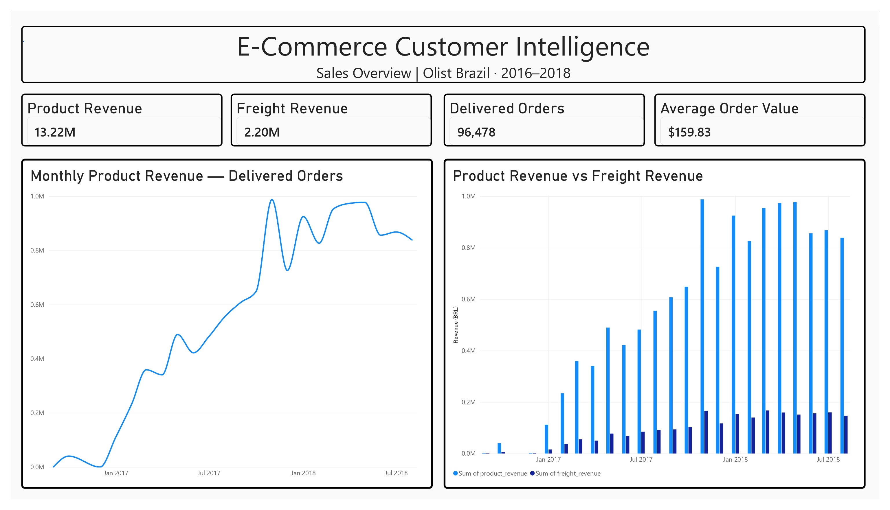
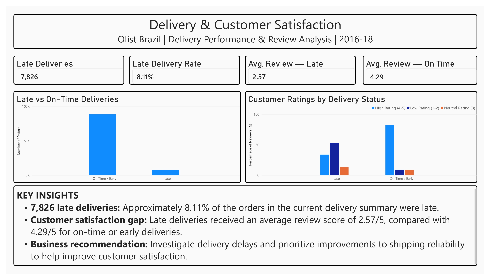
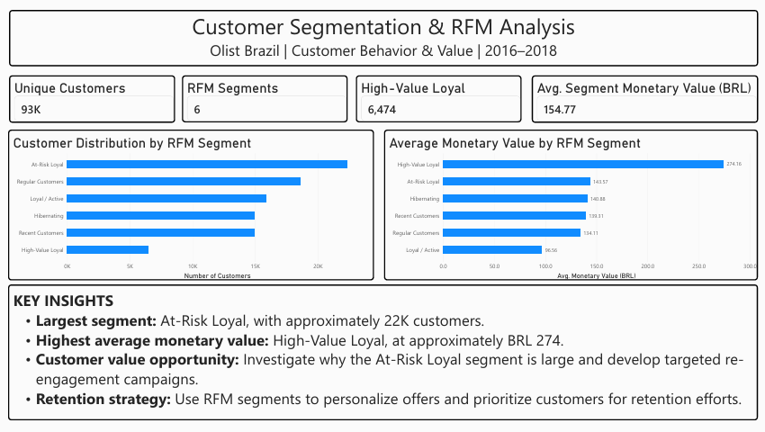

# E-Commerce Customer Intelligence: Retention, Segmentation & Delivery Performance

An end-to-end data analytics portfolio project using **Python, PostgreSQL, SQL, and Power BI** to analyze e-commerce sales, customer behavior, delivery performance, and customer satisfaction.

The project uses Brazil's Olist e-commerce dataset to transform raw transactional data into business metrics, customer segments, and actionable insights.

## Dashboard Preview

### Page 1 — Sales Overview



Analyzes marketplace revenue, freight revenue, delivered orders, average order value, and monthly product revenue trends.

| KPI | Result |
|---|---:|
| Product Revenue | BRL 13.22M |
| Freight Revenue | BRL 2.20M |
| Delivered Orders | 96,478 |
| Average Order Value | BRL 159.83 |

### Page 2 — Delivery & Customer Satisfaction



Compares late deliveries with on-time or early deliveries and examines how delivery performance relates to customer review scores.

| KPI | Result |
|---|---:|
| Late Deliveries | 7,826 |
| Late Delivery Rate | 8.11% |
| Average Review — Late Deliveries | 2.57/5 |
| Average Review — On-Time or Early Deliveries | 4.29/5 |

The results show lower average review scores for late deliveries. This indicates an association between delivery experience and customer satisfaction, not proof of causation.

### Page 3 — Customer Segmentation & RFM Analysis



Uses Recency, Frequency, and Monetary (RFM) analysis to examine customer segments, customer value, and potential retention opportunities.

| KPI | Result |
|---|---:|
| Unique Customers | Approximately 93K |
| RFM Segments | 6 |
| High-Value Loyal Customers | 6,474 |
| Average Segment Monetary Value | BRL 154.77 |

The current analysis identifies **At-Risk Loyal** as the largest segment, with approximately 22K customers. **High-Value Loyal** has the highest average segment monetary value, at approximately BRL 274.

*Values reflect the current dashboard calculations and segmentation rules.*

---

## Project Objectives

- Analyze product revenue, freight revenue, and monthly sales trends.
- Calculate business KPIs using SQL and PostgreSQL.
- Assess delivery performance and late-delivery rates.
- Compare customer reviews across delivery categories.
- Investigate customer purchasing behavior.
- Segment customers using RFM analysis.
- Identify high-value and at-risk customer groups.
- Communicate findings through Power BI dashboards.

## Technology Stack

| Technology | Application |
|---|---|
| Python | Data inspection and exploratory analysis |
| Pandas | Data manipulation and cleaning |
| NumPy | Numerical operations |
| Matplotlib & Seaborn | Exploratory data visualization |
| PostgreSQL | Relational data storage and analysis |
| SQL | Joins, aggregations, KPI calculations, and segmentation |
| Power BI | Dashboard development and reporting |
| Jupyter Notebook | Exploratory data analysis |
| Git & GitHub | Version control and project documentation |

## Dataset

**Source:** [Brazilian E-Commerce Public Dataset by Olist — Kaggle](https://www.kaggle.com/datasets/olistbr/brazilian-ecommerce)

The dataset contains approximately 100,000 orders from Brazil between 2016 and 2018, across multiple related CSV files.

Datasets used include:

- Customers
- Orders
- Order items
- Order payments
- Order reviews
- Products
- Sellers
- Product category translations
- Geolocation

The dataset was inspected for missing values, duplicate records, key uniqueness, and relationships between tables. Order timestamps were converted to datetime values for delivery and sales analysis.

**Dataset licensing:** The dataset is published under CC BY-NC-SA 4.0. Refer to the original Kaggle page for attribution and reuse requirements. Raw CSV files are not included in this repository.

## Work Completed

### 1. Data Inspection and Quality Checks

- Inspected dataset dimensions, columns, data types, and missing values.
- Investigated candidate primary keys and duplicate records.
- Checked relationships between the principal datasets.
- Examined missing delivery timestamps and order-status distributions.
- Validated timestamp relationships for key order events.

### 2. PostgreSQL Database Setup

- Created tables for the Olist datasets.
- Imported the CSV files into PostgreSQL.
- Verified the imported row counts.
- Checked candidate key uniqueness and table relationships.

The imported datasets contain approximately **1.55 million rows in total**, including the large geolocation dataset.

### 3. SQL Business Analysis

Created and executed SQL analyses covering:

- Order-status distribution.
- Product revenue and freight revenue.
- Delivered orders and average order value.
- Monthly product revenue.
- Repeat-customer metrics.
- Delivery performance.
- Customer review distributions.
- RFM customer segmentation.

### 4. Python Exploratory Data Analysis

- Loaded the datasets into Pandas DataFrames.
- Inspected dataset shapes, column information, and missing values.
- Converted order timestamp columns to datetime format.
- Investigated missing delivery dates by order status.
- Checked duplicate order IDs and invalid timestamp relationships.

### 5. Power BI Dashboard Development

Completed a three-page Power BI report.

**Page 1: Sales Overview**
- Product Revenue
- Freight Revenue
- Delivered Orders
- Average Order Value
- Monthly Product Revenue trend
- Product Revenue vs Freight Revenue

**Page 2: Delivery & Customer Satisfaction**
- Late Deliveries
- Late Delivery Rate
- Average Review for Late Deliveries
- Average Review for On-Time or Early Deliveries
- Late vs On-Time Deliveries chart
- Customer Ratings by Delivery Status chart
- Written key insights and recommendations

**Page 3: Customer Segmentation & RFM Analysis**
- Unique Customers
- RFM Segments
- High-Value Loyal Customers
- Average Segment Monetary Value
- Customer Distribution by RFM Segment
- Average Monetary Value by RFM Segment
- Written key insights and retention recommendations

The dashboard screenshots are saved in the `screenshots/` directory.

## Key Business Insights

### Sales

- The analysis reports BRL 13.22 million in product revenue and BRL 2.20 million in freight revenue.
- Monthly product revenue provides a view of marketplace sales trends over the observed period.

### Delivery and Satisfaction

- The current delivery summary reports 7,826 late deliveries and an 8.11% late-delivery rate.
- Average reviews are lower for late deliveries than for on-time or early deliveries.
- Delivery reliability is a potential area for operational improvement.

### Customer Segmentation

- At-Risk Loyal is the largest RFM segment in the current dashboard.
- High-Value Loyal has the highest average segment monetary value.
- Customer segments can help prioritize retention analysis and targeted engagement.

## Business Recommendations

1. **Improve delivery reliability:** Investigate operational factors associated with shipment delays.
2. **Monitor customer satisfaction:** Track review scores by delivery status.
3. **Prioritize retention:** Investigate the At-Risk Loyal segment and evaluate re-engagement strategies.
4. **Understand high-value customers:** Explore the purchasing behavior of High-Value Loyal customers.
5. **Track business KPIs:** Use SQL and Power BI to monitor marketplace performance consistently.

These recommendations are proposed actions based on observed patterns; their effectiveness would require further testing and analysis.

## Repository Structure

```text
Ecommerce-Customer-Intelligence/
│
├── data/
│   ├── raw/
│   └── processed/
│
├── notebooks/
│   └── 01_ecommerce_eda.ipynb
│
├── scripts/
│   ├── 01_inspect_data.py
│   ├── 02_data_quality_report.py
│   ├── 03_investigate_orders.py
│   └── 04_check_relationships.py
│
├── sql/
│   ├── 01_create_tables.sql
│   ├── 02_verify_tables.sql
│   ├── 03_business_analysis.sql
│   └── 04_customer_segmentation.sql
│
├── screenshots/
│   ├── 1.jpg
│   ├── 2.jpg
│   └── 3.jpg
│
├── reports/
├── README.md
└── .gitignore
```

*This structure reflects the known project files. Adjust the tree if your actual filenames or folders differ.*

## How to Reproduce the Analysis

1. Download the dataset from the [Olist Kaggle page](https://www.kaggle.com/datasets/olistbr/brazilian-ecommerce).
2. Place the CSV files in `data/raw/`.
3. Create a PostgreSQL database.
4. Execute `sql/01_create_tables.sql`.
5. Import the CSV files into their corresponding tables, respecting foreign-key dependencies.
6. Execute `sql/02_verify_tables.sql` to validate the tables and row counts.
7. Run the SQL analysis scripts.
8. Set up a Python environment with the required libraries.
9. Run the Python inspection scripts and open `notebooks/01_ecommerce_eda.ipynb`.
10. Open the Power BI report, configure the data sources, and refresh the report if needed.

Store database credentials locally. Do not commit passwords, `.env` files, or other secrets to GitHub.

## Skills Demonstrated

- Data quality assessment
- Exploratory data analysis
- Python and Pandas
- PostgreSQL and SQL
- Relational data validation
- Business KPI development
- Delivery performance analysis
- Customer review analysis
- RFM customer segmentation
- Power BI dashboard design
- Business insight communication
- GitHub documentation

## Future Enhancements

- Develop customer cohort-retention analysis.
- Investigate factors associated with delivery delays.
- Automate data-quality checks.
- Extend repeat-purchase and customer-lifetime-value analysis.
- Develop a repeatable data-refresh workflow.

## Acknowledgements

Dataset: [Brazilian E-Commerce Public Dataset by Olist](https://www.kaggle.com/datasets/olistbr/brazilian-ecommerce), published on Kaggle.

